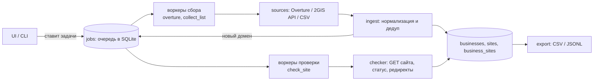

# Устройство проекта

## Поток данных

Принцип: **единственный источник правды о работе это таблица `jobs`**. UI и CLI только добавляют туда задачи,
воркеры забирают их оттуда. Поэтому остановка, перезапуск и повтор безопасны, а новые источники добавляются без переписывания остального.

## Модули

| Модуль | Отвечает за |
|---|---|
| `cli.py` | команды `ui`, `overture`, `run`, `import`, `export`, `stats`, `recheck`, `probe`, `retry-failed` |
| `config.py` | `config.yaml` + секреты из `.env` |
| `storage.py` | схема SQLite, очередь (`enqueue`, `claim`, `retry`), выборки для UI и экспорта, миграции |
| `normalize.py` | URL → домен и тип (`own` / `social` / `marketplace`), телефоны → `+7...`, пометки сайта (`parked`, `redirect:`) |
| `export.py` | потоковая выгрузка CSV и JSONL |
| `pipeline/runner.py` | воркеры, ретраи, пауза/стоп, обработчики задач `overture`, `collect_list`, `check_site` |
| `pipeline/ingest.py` | запись карточки в базу и постановка проверки сайта (общее для всех источников) |
| `pipeline/checker.py` | проверка доступности сайта: браузерные заголовки, https затем http, любой HTTP-ответ = сайт жив, причина отказа сохраняется (`error:<причина>`); временные сбои (`timeout`, `reset`, `connect`, `dns`) откладываются и повторяются до 3 раз |
| `pipeline/leadgen.py` | отправка сайтов этапу 2 по API (пакеты, повторы, `Retry-After`) и синхронизация статусов |
| `pipeline/limiter.py` | глобальный лимит запросов к 2GIS, пауза при 429/403 |
| `sources/overture.py` | город → рамка, скачивание, фильтр по теме, оркестрация |
| `sources/api2gis.py` | клиент 2GIS Places API |
| `sources/csv_import.py` | загрузка внешних таблиц |
| `ui/app.py` + `templates/` | веб-интерфейс (FastAPI + Jinja2, без сборки фронтенда) |

## База данных (`data/dgis.db`)

| Таблица | Содержимое |
|---|---|
| `businesses` | организация: `dgis_id` (с префиксом источника, например `ovt:`), название, адрес, город, рубрика, телефоны, `site_kind` |
| `sites` | **только собственные сайты**: `domain` (ключ), `url`, `http_status`, `final_url`, `note`, `analysis_status` |
| `business_sites` | связь «организация ↔ сайт» (у сети один сайт на много филиалов) |
| `jobs` | очередь: тип, параметры, статус, попытки, ошибка, `uniq` (защита от дублей) |
| `geocache` | кэш «город → рамка» |

`site_kind` в `businesses`: `own`, `social`, `marketplace`, `none`. Соцсети и агрегаторы в `sites` не попадают.

## Очередь

- Типы задач: `overture` (тяжёлая, одна за раз, 2 попытки), `collect_list` (2GIS, пагинация), `check_site` (20 параллельно).
- Статусы: `queued → running → done | failed`. При ошибке задача возвращается в очередь с нарастающей паузой.
- При остановке и старте зависшие `running` возвращаются в `queued`.
- `uniq` не даёт поставить ту же задачу дважды; флаг «повторить» (`force`) сбрасывает выполненную.

## Как добавить новый источник

1. Получить таблицу и привести к колонкам `websites, name, address, phones, category`.
2. Загрузить через `sources/csv_import.py` (`import_csv`), дальше работает общий конвейер.
Если нужен полноценный источник с пагинацией, реализуйте интерфейс `Source` (`sources/base.py`) и добавьте тип задачи в `pipeline/runner.py`.

## Что не сделано

Расписания (APScheduler), сбор через браузер (Playwright), прокси, дедуп организаций по телефону, стыковка с этапом 2.
